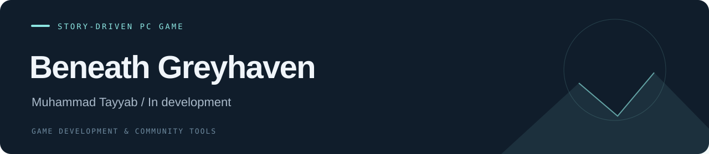

# Beneath Greyhaven

**Story-Driven Pc Game · In development**

A man enters a village to rescue his captured wife from extraterrestrial authorities who are holding her for experiments. The game combines a rescue narrative, an unsettling village setting and cinematic storytelling.

| Project | Details |
| --- | --- |
| Developer | Muhammad Tayyab |
| Progress | In development |
| Tools / focus | Unity · C# · Blender |
| Repository contents | Project documentation, repository configuration and a Unity project audit tool |

## Development direction

- Modern rural village environments and atmospheric level design.
- Combat against the forces occupying the village.
- Cutscenes and narrative progression around the rescue mission.
- PC development, with Steam as the intended release platform.

## Repository status

The project is in development. The points above describe the intended game direction; they do not imply that every system is implemented.

## Media

See the [media guide](./media/README.md) for the project captures to add.

## Developer tools

The [Unity project audit](./tools/README.md) checks project structure and asset metadata before source import. It is a read-only Python tool with a regression test suite.

## Source project

The [source import guide](./docs/ADDING_SOURCE.md) describes the repository layout for adding the real Unity project.

---

[All projects](https://github.com/tabi-malikx) · [Project catalogue](https://github.com/tabi-malikx/tabi-malikx#selected-projects)
